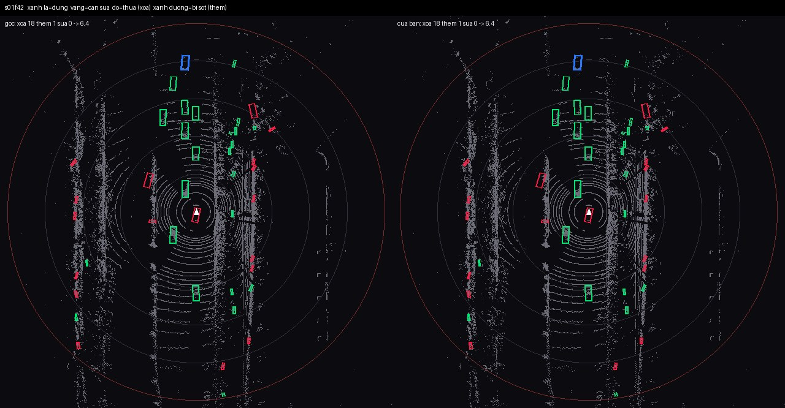

# Báo cáo Day 14 — Hoàng Quang Trường — 2A202603347

> Sao chép file này thành `report/individual/2A202603347_<HoTen>.md` (không dấu), ví dụ `2A20260000_NguyenVanAn.md`.

- Mã học viên dùng với `--student`: `347`
- `seed_tag` trong `frames_A.txt`: `82ac3100fd`

## 1. Dự đoán trước sweep (bước 5b)

Ghi **trước** khi chạy `scripts/pp_sweep.py`, rồi commit và push ngay (lịch sử commit là bằng chứng thời điểm viết). Không sửa phần này sau khi có kết quả.

- Tham số tôi nghĩ giảm công sửa nhiều nhất: Kết hợp tăng cả score_thr và min_points.
- Vì sao (nhìn ảnh BEV tập A: box thừa nhiều hay box sót nhiều?): Tôi cho rằng kết hợp hai tham số sẽ giúp giữ lại các dự đoán rõ ràng và đáng tin cậy hơn, từ đó dễ kiểm tra đối tượng và giảm công sửa nhãn.

## 2. T?p A: s?a tay v? tune

| C?u h?nh | X?a | Th?m | S?a | Chi ph? |
|---|---:|---:|---:|---:|
| G?c | 20 | 1 | 0 | 7.0 |
| best_config.json | 20 | 1 | 0 | 7.0 |

- T?ng prediction: 118 cuboid.
- T?ng reference: 99 cuboid.
- ?? th? 15 c?u h?nh.
- C?u h?nh t?i ?u: `score_thr=0.1`, `min_points=0`.
- Kh?ng thay ??i tham s? so v?i baseline.
- C?u h?nh 0.2/0 c?ng ??t chi ph? 7.0.

### Leave-one-out

| Holdout | score_thr | min_points | Train cost | Holdout cost | Oracle cost |
|---|---:|---:|---:|---:|---:|
| s01f42 | 0.1 | 0 | 0.6 | 6.4 | 6.4 |
| s03f52 | 0.1 | 0 | 6.4 | 0.6 | 0.6 |
| s05f19 | 0.1 | 0 | 7.0 | 0.0 | 0.0 |

### Nh?n x?t s? li?u c? h? tr? AI

C?u h?nh g?c ??t chi ph? th?p nh?t trong c? ba l??t
leave-one-out khi ch?n ng??ng nh? h?n trong tr??ng h?p
??ng h?ng. Chi ph? holdout b?ng chi ph? oracle.
Tuy nhi?n, t?p A ch? g?m 3 frame n?n ch?a ?? c?n c?
?? kh?ng ??nh kh? n?ng t?ng qu?t h?a.

## 3. Tr??c/sau (b??c 8)

| score_thr | min_points | X?a | Th?m | S?a | Chi ph? |
|---:|---:|---:|---:|---:|---:|
| 0.1 | 0 | 20 | 1 | 0 | 7.0 |
| 0.2 | 0 | 20 | 1 | 0 | 7.0 |
| 0.1 | 5 | 20 | 2 | 0 | 8.0 |
| 0.2 | 5 | 20 | 2 | 0 | 8.0 |
| 0.1 | 10 | 20 | 4 | 0 | 10.0 |
| 0.2 | 10 | 20 | 4 | 0 | 10.0 |
| 0.3 | 0 | 15 | 11 | 0 | 15.5 |
| 0.3 | 5 | 15 | 12 | 0 | 16.5 |
| 0.3 | 10 | 15 | 14 | 0 | 18.5 |
| 0.4 | 0 | 9 | 37 | 0 | 39.7 |
| 0.4 | 5 | 9 | 38 | 0 | 40.7 |
| 0.4 | 10 | 9 | 39 | 0 | 41.7 |
| 0.5 | 0 | 4 | 54 | 0 | 55.2 |
| 0.5 | 5 | 4 | 54 | 0 | 55.2 |
| 0.5 | 10 | 4 | 54 | 0 | 55.2 |

- Chi ph? baseline: 7.0.
- Chi ph? t?i ?u: 7.0.
- M?c gi?m chi ph?: 0%.

### ??i chi?u s? li?u c? h? tr? AI

K?t qu? sweep kh?ng ?ng h? d? ?o?n ban ??u r?ng
t?ng ??ng th?i score_thr v? min_points s? gi?m c?ng s?a.
? c?u h?nh 0.5/10, s? box c?n x?a gi?m t? 20 xu?ng 4,
nh?ng s? box c?n th?m t?ng t? 1 l?n 54.
Chi ph? t?ng t? 7.0 l?n 55.2.

K?t lu?n c? nh?n c?a h?c vi?n: ch?a b? sung.

## 4. T?p B

- S? frame: 12.
- Prediction: 356 cuboid.
- Reference xu?t t? CVAT: 184 cuboid.
- S? box kh?p: 184.

| X?a | Th?m | S?a | Chi ph? |
|---:|---:|---:|---:|
| 172 | 0 | 0 | 51.6 |

### K?t qu? t?ng frame

| Frame | Prediction | Reference | X?a | Chi ph? |
|---|---:|---:|---:|---:|
| s01f03 | 29 | 20 | 9 | 2.7 |
| s01f19 | 28 | 14 | 14 | 4.2 |
| s01f34 | 40 | 14 | 26 | 7.8 |
| s02f10 | 28 | 20 | 8 | 2.4 |
| s02f35 | 32 | 15 | 17 | 5.1 |
| s02f54 | 38 | 11 | 27 | 8.1 |
| s03f06 | 20 | 14 | 6 | 1.8 |
| s03f24 | 35 | 12 | 23 | 6.9 |
| s03f45 | 40 | 14 | 26 | 7.8 |
| s04f07 | 26 | 19 | 7 | 2.1 |
| s04f28 | 20 | 18 | 2 | 0.6 |
| s04f49 | 20 | 13 | 7 | 2.1 |
| T?ng | 356 | 184 | 172 | 51.6 |

### Th?ng k? theo l?p

| L?p | Prediction | Reference | X?a |
|---|---:|---:|---:|
| Car | 256 | 157 | 99 |
| Truck | 0 | 0 | 0 |
| Bus | 0 | 0 | 0 |
| Cyclist | 80 | 21 | 59 |
| Pedestrian | 20 | 6 | 14 |

- Car c? s? box b? x?a l?n nh?t: 99.
- Cyclist c? t? l? b? x?a cao nh?t: 73.75%.
- Chi ph? trung b?nh: 4.3/frame.
- S? d?ng QA h? tr? AI v? CVAT SDK ?? ph?n t?ch,
  sao l?u v? lo?i b? 172 cuboid nghi v?n.
- Ch?a x?c nh?n vi?c ki?m tra th? c?ng ??y ?? t?p B.

## 5. Gi?i h?n

1. T?p A ch? c? 3 frame, ch?a ?? ??i di?n cho to?n b? d? li?u.
2. PointPillars hu?n luy?n tr?n KITTI kh?ng tr?c ti?p
   nh?n di?n ??y ?? Truck v? Bus theo taxonomy c?a lab.
3. Chi ph? s?a l? c?ng th?c quy ??i, kh?ng ph?i th?i gian
   ch?nh s?a th?c t?.
4. T?ng ng??ng confidence c? th? lo?i b? ??i t??ng th?t.
5. Reference B ???c t?o v?i h? tr? QA t? ??ng,
   ch?a ???c x?c minh ??c l?p ??y ?? v? ??i t??ng b? s?t,
   class, yaw v? h?nh h?c cuboid.
