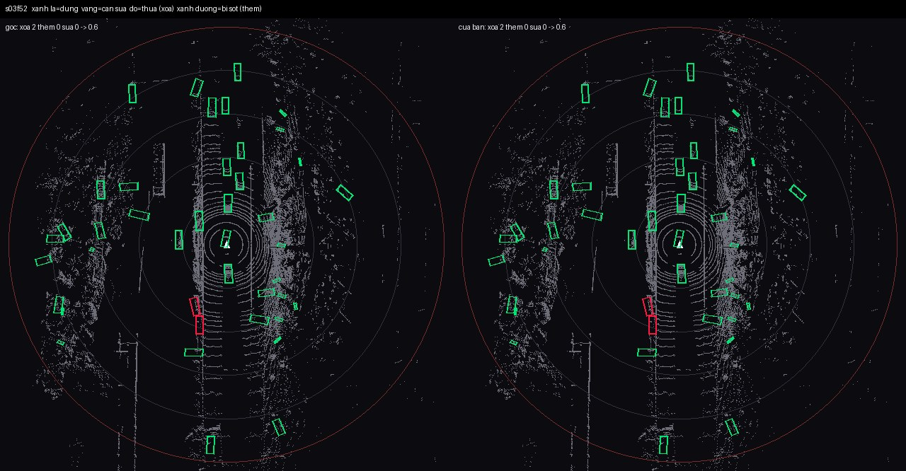
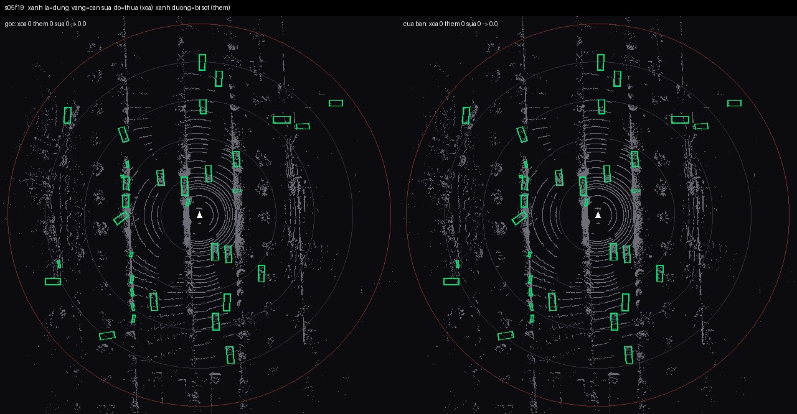

# Báo cáo Day 14 — Hoàng Quang Trường — 2A202603347

> Sao chép file này thành `report/individual/2A202603347_<HoTen>.md` (không dấu), ví dụ `2A20260000_NguyenVanAn.md`.

- Mã học viên dùng với `--student`: `347`
- `seed_tag` trong `frames_A.txt`: `82ac3100fd`

## 1. Dự đoán trước sweep (bước 5b)

Ghi **trước** khi chạy `scripts/pp_sweep.py`, rồi commit và push ngay (lịch sử commit là bằng chứng thời điểm viết). Không sửa phần này sau khi có kết quả.

- Tham số tôi nghĩ giảm công sửa nhiều nhất: Kết hợp tăng cả score_thr và min_points.
- Vì sao (nhìn ảnh BEV tập A: box thừa nhiều hay box sót nhiều?): Tôi cho rằng kết hợp hai tham số sẽ giúp giữ lại các dự đoán rõ ràng và đáng tin cậy hơn, từ đó dễ kiểm tra đối tượng và giảm công sửa nhãn.

## 2. Tập A: sửa tay và tune

| Cấu hình | Xóa | Thêm | Sửa | Chi phí |
|---|---:|---:|---:|---:|
| Gốc | 20 | 1 | 0 | 7.0 |
| `best_config.json` | 20 | 1 | 0 | 7.0 |

- Prediction: 118 cuboid; reference: 99 cuboid.
- Sweep 15 cấu hình. Cấu hình được chọn: `score_thr=0.1`, `min_points=0`; không thay đổi so với baseline. Cấu hình 0.2/0 đồng hạng.

### Leave-one-out (tính lại từ sweep.csv)

| Holdout | score_thr | min_points | Train cost | Holdout cost | Oracle cost |
|---|---:|---:|---:|---:|---:|
| s01f42 | 0.1 | 0 | 0.6 | 6.4 | 6.4 |
| s03f52 | 0.1 | 0 | 6.4 | 0.6 | 0.6 |
| s05f19 | 0.1 | 0 | 7.0 | 0.0 | 0.0 |

Cả ba lượt có cấu hình 0.1/0 đạt chi phí train thấp nhất và chi phí holdout bằng oracle; 0.2/0 đồng hạng. Đây là thống kê trên ba frame, không phải bằng chứng tổng quát hóa.

### Bảng sweep

| score_thr | min_points | Xóa | Thêm | Sửa | Chi phí |
|---:|---:|---:|---:|---:|---:|
| 0.1 | 0 | 20 | 1 | 0 | 7.0 |
| 0.2 | 0 | 20 | 1 | 0 | 7.0 |
| 0.1 | 5 | 20 | 2 | 0 | 8.0 |
| 0.2 | 5 | 20 | 2 | 0 | 8.0 |
| 0.1 | 10 | 20 | 4 | 0 | 10.0 |
| 0.2 | 10 | 20 | 4 | 0 | 10.0 |
| 0.3 | 0 | 15 | 11 | 0 | 15.5 |
| 0.3 | 5 | 15 | 12 | 0 | 16.5 |
| 0.3 | 10 | 15 | 14 | 0 | 18.5 |
| 0.4 | 0 | 9 | 37 | 0 | 39.7 |
| 0.4 | 5 | 9 | 38 | 0 | 40.7 |
| 0.4 | 10 | 9 | 39 | 0 | 41.7 |
| 0.5 | 0 | 4 | 54 | 0 | 55.2 |
| 0.5 | 5 | 4 | 54 | 0 | 55.2 |
| 0.5 | 10 | 4 | 54 | 0 | 55.2 |

## 3. Trước/sau (bước 8)

- Chi phí baseline và cấu hình được chọn: 7.0.
- Mức giảm chi phí: 0%.
- Số liệu đối chiếu: ở cấu hình 0.5/10, số box cần xóa là 4 thay vì 20; số box cần thêm là 54 thay vì 1; chi phí là 55.2 thay vì 7.0.

**Kết luận đối chiếu cá nhân:** chưa bổ sung.

## 4. Tập B

Kết quả của lệnh đo ở bước 9 trên reference hiện tại: 12 frame, 356 prediction, 184 reference, 184 box khớp.

| Xóa | Thêm | Sửa | Chi phí |
|---:|---:|---:|---:|
| 172 | 0 | 0 | 51.6 |

| Frame | Prediction | Reference | Xóa | Chi phí |
|---|---:|---:|---:|---:|
| s01f03 | 29 | 20 | 9 | 2.7 |
| s01f19 | 28 | 14 | 14 | 4.2 |
| s01f34 | 40 | 14 | 26 | 7.8 |
| s02f10 | 28 | 20 | 8 | 2.4 |
| s02f35 | 32 | 15 | 17 | 5.1 |
| s02f54 | 38 | 11 | 27 | 8.1 |
| s03f06 | 20 | 14 | 6 | 1.8 |
| s03f24 | 35 | 12 | 23 | 6.9 |
| s03f45 | 40 | 14 | 26 | 7.8 |
| s04f07 | 26 | 19 | 7 | 2.1 |
| s04f28 | 20 | 18 | 2 | 0.6 |
| s04f49 | 20 | 13 | 7 | 2.1 |
| Tổng | 356 | 184 | 172 | 51.6 |

| Lớp | Prediction | Reference | Xóa |
|---|---:|---:|---:|
| Car | 256 | 157 | 99 |
| Truck | 0 | 0 | 0 |
| Bus | 0 | 0 | 0 |
| Cyclist | 80 | 21 | 59 |
| Pedestrian | 20 | 6 | 14 |

Car có số box bị xóa lớn nhất (99); Cyclist có tỷ lệ xóa cao nhất (73.75%). Chi phí trung bình 4.3/frame.

### Công cụ hỗ trợ và trạng thái QA

Đã dùng ChatGPT để phân tích ảnh chiếu camera và thống kê điểm LiDAR, dùng script Python/CVAT SDK để sao lưu và xóa 172 box theo đề xuất QA. Đã xuất nhãn bằng script chính thức của lab. Các số đo trên phản ánh reference hiện tại, không phải ground truth độc lập. Chưa xác nhận kiểm tra thủ công đầy đủ; chưa thêm box sót hoặc chỉnh hình học trong tập B.

### Nghi vấn chưa được xác nhận (theo mục 4 guideline)

| Frame | Vị trí (pp_id của prediction) | Loại nghi vấn | Mô tả |
|---|---|---|---|
| s01f03 | 11 | UNCERTAIN_CLASS | Vùng chiếu xe tải hộp trắng; phân biệt xe tải và xe con bị che. |
| s01f19 | 9, 12 | ATTRIBUTE_CHECK | Vùng xe bị che cạnh xe buýt; chưa xác nhận vật thể và cờ occluded. |
| s01f34 | 33 | UNCERTAIN_CLASS | Người cạnh xe/cột; kiểm tra đi bộ, dắt xe hay đang lái. |
| s02f10 | 2 | UNCERTAIN_CLASS | Van xanh: xe hàng hay xe chở người. |
| s02f10 | 12 | UNCERTAIN_CLASS | Người cạnh xe đạp: đang lái hay dắt xe. |
| s04f28 | 17 | UNCERTAIN_CLASS | Cyclist có kích thước dài bất thường; cần đối chiếu camera và point cloud. |

Các mục này là nghi vấn từ QA tự động, không phải lỗi đã được người gán nhãn xác nhận. Chưa đánh dấu đã hỏi coach.

## 5. Giới hạn

- Tập A chỉ gồm 3 frame; chưa đủ đại diện cho toàn bộ dữ liệu.
- Model huấn luyện trên KITTI có 3 lớp trực tiếp; Truck và Bus phụ thuộc luật hậu xử lý kích thước.
- Chi phí sửa là công thức quy đổi, không phải thời gian chỉnh sửa thực tế.
- Reference hiện tại phụ thuộc chất lượng kiểm tra nhãn; không dùng kết quả đo để khẳng định độ chính xác với ground truth độc lập.
- Tập B còn cần xác minh vật thể bị sót, lớp, độ khít, yaw, đáy và occluded theo guideline.
